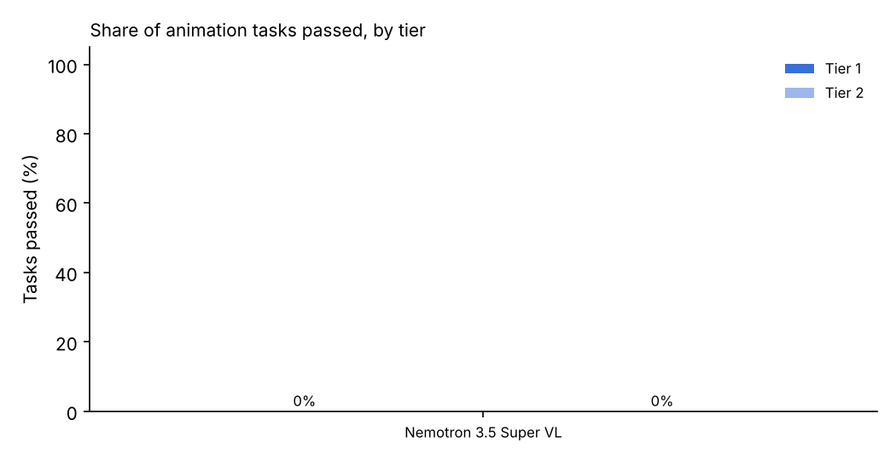
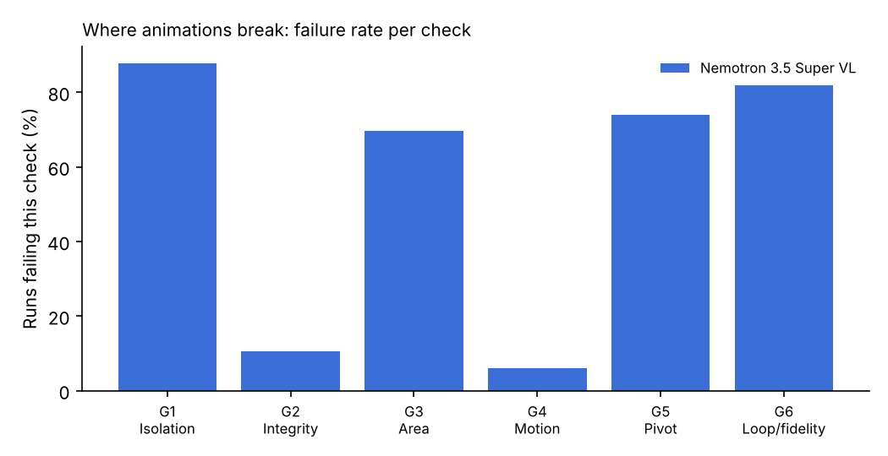

# anibench: can models animate one part of a picture without breaking the rest?

**Vals Hacks, Track 1 (Build Your Own Eval).** Code: `github.com/floflo11/anibench`.

## Summary

Models write three.js that runs, but they cut out the wrong pixels, rotate around the wrong joint and tear hands off.
anibench gives a model a still image of cartoon characters plus one instruction ("wave his raised hand from the wrist",
"make her earrings swing", "lift her hat") and asks for a three.js page that animates only that part. We render the page
to 25 frames and score it with **six image-math checks**, not a model judge.

- **Nemotron 3.5 Super VL passed 0 of 33 scored runs (0%).**
  Of those runs, 17 flipped or shifted the image, 6 left the canvas blank,
  0 never ran, and in the 10 runs that showed the image correctly, the animation was wrong every time.
- The tasks are solvable: in a smoke test, Qwen 3.8 27B produced a correct wrist wave on T01 that passes every check (T01: PASS, T07: RUNTIME).
- Every check is validated before use: a reference animation must pass it, and deliberately broken copies must fail it.

## Why this benchmark

Code-generation benchmarks mostly check that code runs. Animation adds a visual contract that is easy to state and hard to
meet: move *this* part, around *this* joint, and leave every other pixel alone. Closest prior work tests different things:
WorldCoder-Bench checks interactive three.js worlds through exposed state, Animation2Code turns recorded web animations back into
code, and Lottie/SVG benchmarks animate from text with no source image to preserve. Classic pipelines (Meta's Animated Drawings,
AniClipart) cut out and rig drawings without a model writing code; we borrow their failure stages: cut-out, pivot, motion, isolation.

## Tasks

24 tasks on two images (six characters). 21 are scored automatically; 3 (thumbs up, walk, clap) need pixels that don't exist in
the image and are human-labeled only.

| Tier | Tasks | What makes them hard |
| --- | --- | --- |
| 1 (12) | Waves from wrist, elbow or shoulder; nods; head tilt; earrings; pigtails; four kids waving at once | One rigid part, an exact pivot, everything else frozen |
| 2 (9) | Hat lift and tilt; jump; squat; knee bounce; veil flutter; left/right wording | Uncovering hidden pixels, whole-body motion, isolation, viewer-vs-character left/right |
| 3 (3) | Thumbs up, walk in place, clap | Not scorable from pixels; demo material |

**Output contract** (same for every task): one HTML file, three.js from a local copy, canvas exactly the image size at pixel ratio 1,
frame 0 identical to the image, a 2-second seamless loop, and `window.setTime(t)` that renders time `t` synchronously.

## Checks

Frames are rendered in headless Chromium with software WebGL, by calling `setTime` at 25 evenly spaced times.

| Check | Fails when | Catches |
| --- | --- | --- |
| G1 Isolation | Pixels change outside the region the moving part can sweep | Wrong part, whole image moving, other characters moving |
| G2 Integrity | New separate pieces appear in the moving region | Detached fingers, torn fragments |
| G3 Area | Foreground lost or gained by more than half the part's own area (hats: the head under it must stay filled) | Holes, missing or duplicated parts |
| G4 Motion | Under 20% of the part's pixels change at peak | Frozen output, motion declared but not drawn |
| G5 Pivot | Over 20% of the part's pixels at the joint change | Rotating around the wrong point |
| G6 Loop and fidelity | Frame at t=2 differs from t=0, or frame 0 differs from the image | Loop jumps, flipped or shifted images |

### Validation (before any model ran)

For each of the 21 scored tasks we built a reference animation from hand-made part masks and pivots, plus 7 broken copies.
A check counts for a task only if the reference passes it (109 of 119 task-check pairs kept; see
`validation/admission.md`). Broken copies caught where an intended check applies:

| Broken copy | Caught |
| --- | --- |
| whole | 21/21 |
| missed thumb | 4/12 |
| hole | 21/21 |
| frozen | 21/21 |
| center pivot | 12/13 |
| no loop | 20/21 |
| wrong part | 21/21 |

The weakest check is **G2 on small fragments**: a leftover piece that keeps touching the moving part is not separated.

## Results

| Model | Scored runs | Passed | Tier 1 | Tier 2 | Didn't run | Cost |
| --- | --- | --- | --- | --- | --- | --- |
| Nemotron 3.5 Super VL | 33 | 0 (0%) | 0/24 | 0/9 | 0 | $0 |

## Failure rate per check

| Check | Nemotron 3.5 Super VL |
| --- | --- |
| G1 Isolation | 29/33 |
| G2 Integrity | 2/19 |
| G3 Area | 23/33 |
| G4 Motion | 2/33 |
| G5 Pivot | 17/23 |
| G6 Loop/fidelity | 27/33 |





Per-run detail: `results/runs.csv`. Every run's animation: `results/library/`.


### Failure rate per check (Nemotron 3.5 Super VL)

| Check | Runs failing |
| --- | --- |
| G1 Isolation | 29/33 (88%) |
| G2 Integrity | 2/19 (11%) |
| G3 Area | 23/33 (70%) |
| G4 Motion | 2/33 (6%) |
| G5 Pivot | 17/23 (74%) |
| G6 Loop and fidelity | 27/33 (82%) |

### What the failures look like

- **Hand at the knee (T01).** The model whited out a box where the hand was, then drew the hand waving at the boy's knee: it used
  image coordinates in a y-up camera.
- **Head disappears (T09, "nod").** Most of the head vanishes; G2 and G3 fail.
- **White bar through the face (T14, hat tilt).** The cut-out rectangle is blanked and never refilled; G1 fails.
- **Gap at the wrist (T21).** The hand rotates away from the forearm, leaving a white gap; G5 fails.
- **Floating fingers (T03).** A rectangular cut leaves fingertips behind; G1, G5, G6 fail.

All runs are in `results/library/` as GIFs.

## Limits

- One model ran the full set. Claude Sonnet 5.5 and GPT-6.1 Sol were planned but the OpenRouter account had no credits overnight;
  the runner is ready to add them (`runs/jobs/full.json`).
- Single-turn generation with one repair turn for outputs that don't run. An agent that renders and looks at its own output
  might do much better; that's the natural next experiment.
- Checks are tolerant of faint artifacts (e.g. a light halo around a cut-out), and G2 misses small attached fragments.
- Masks and pivots are hand-annotated on two images; more images and characters would make results more general.
- No check scores motion quality (natural vs. robotic). Next step: a video-model judge, validated against human labels.

## Reproduce

```bash
python3 src/parts.py && python3 src/tasks.py      # masks, tasks
python3 src/reference.py && python3 src/validate.py && python3 src/admission.py   # grader validation
python3 src/jobs.py make full sonnet,sol 3        # job list; run with src/browser_runner.js or any OpenRouter client
python3 src/jobs.py ingest <results.json> && python3 src/grade_runs.py && python3 src/report.py
python3 src/export_harbor.py                      # Harbor tasks for Valkyrie
```
