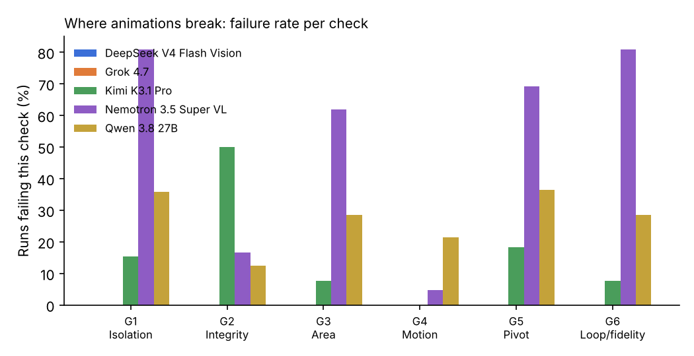

# Results

| Model | Scored runs | Passed | Tier 1 | Tier 2 | Didn't run | Cost |
| --- | --- | --- | --- | --- | --- | --- |
| DeepSeek V4 Flash Vision | 12 | 1 (8%) | 0/8 | 1/4 | 11 | $0.506 |
| Grok 4.7 | 12 | 0 (0%) | 0/9 | 0/3 | 12 | $0.287 |
| Kimi K3.1 Pro | 13 | 8 (62%) | 5/9 | 3/4 | 0 | $2.721 |
| Nemotron 3.5 Super VL | 21 | 0 (0%) | 0/12 | 0/9 | 0 | $0 |
| Qwen 3.8 27B | 15 | 6 (40%) | 4/10 | 2/5 | 1 | $0.458 |

## Failure rate per check

| Check | DeepSeek V4 Flash Vision | Grok 4.7 | Kimi K3.1 Pro | Nemotron 3.5 Super VL | Qwen 3.8 27B |
| --- | --- | --- | --- | --- | --- |
| G1 Isolation | 0/1 | 0/0 | 2/13 | 17/21 | 5/14 |
| G2 Integrity | 0/0 | 0/0 | 4/8 | 2/12 | 1/8 |
| G3 Area | 0/1 | 0/0 | 1/13 | 13/21 | 4/14 |
| G4 Motion | 0/1 | 0/0 | 0/13 | 1/21 | 3/14 |
| G5 Pivot | 0/1 | 0/0 | 2/11 | 9/13 | 4/11 |
| G6 Loop/fidelity | 0/1 | 0/0 | 1/13 | 17/21 | 4/14 |

Per-run detail: `runs.csv`. Every run's animation: `library/`.
