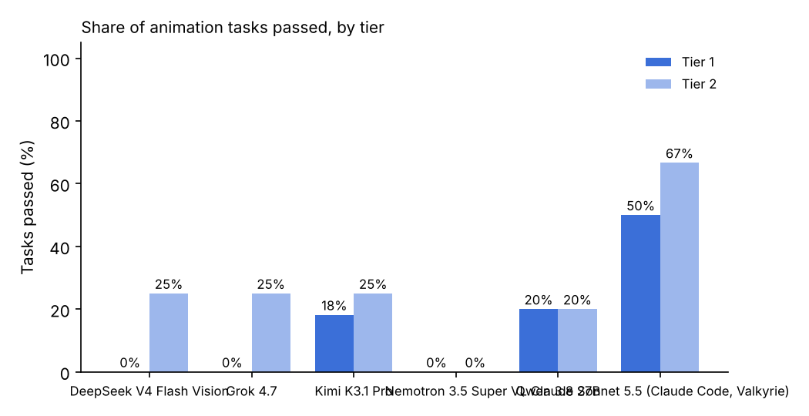

# Results

| Model | Scored runs | Passed | Tier 1 | Tier 2 | Didn't run | Cost |
| --- | --- | --- | --- | --- | --- | --- |
| DeepSeek V4 Flash Vision | 13 | 1 (8%) | 0/9 | 1/4 | 12 | $0.549 |
| Grok 4.7 | 14 | 1 (7%) | 0/10 | 1/4 | 12 | $1.415 |
| Kimi K3.1 Pro | 15 | 3 (20%) | 2/11 | 1/4 | 0 | $3.113 |
| Nemotron 3.5 Super VL | 21 | 0 (0%) | 0/12 | 0/9 | 0 | $0 |
| Qwen 3.8 27B | 15 | 3 (20%) | 2/10 | 1/5 | 1 | $0.458 |
| Claude Sonnet 5.5 (Claude Code, Valkyrie) | 21 | 12 (57%) | 6/12 | 6/9 | 0 | not reported |

## Failure rate per check

| Check | DeepSeek V4 Flash Vision | Grok 4.7 | Kimi K3.1 Pro | Nemotron 3.5 Super VL | Qwen 3.8 27B | Claude Sonnet 5.5 (Claude Code, Valkyrie) |
| --- | --- | --- | --- | --- | --- | --- |
| G1 Isolation | 0/1 | 0/2 | 2/15 | 16/21 | 5/14 | 4/21 |
| G2 Integrity | 0/0 | 1/2 | 4/10 | 4/14 | 1/9 | 3/12 |
| G2b Connectivity | 0/1 | 1/2 | 9/14 | 7/20 | 4/13 | 0/0 |
| G2c Residual | 0/1 | 1/1 | 6/14 | 3/19 | 2/12 | 0/0 |
| G3 Area | 0/1 | 0/2 | 1/15 | 12/21 | 4/14 | 3/21 |
| G4 Motion | 0/1 | 0/2 | 0/15 | 1/21 | 3/14 | 1/21 |
| G5 Pivot | 0/1 | 1/1 | 4/14 | 13/16 | 4/12 | 5/13 |
| G6 Loop/fidelity | 0/1 | 0/2 | 1/15 | 17/21 | 4/14 | 3/21 |

Per-run detail: `runs.csv`. Every run's animation: `library/`.
