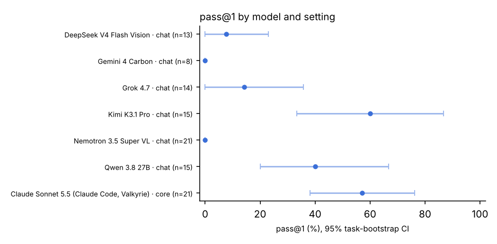

# Results by evaluation protocol

Generated by `src/report.py`; definitions in `docs/protocol.md`. pass@1 and partial credit are means over tasks of the per-task mean over k samples, in %, with 95% task-bootstrap CIs (10000 resamples, seed 0). Settings `core` (legacy Valkyrie dataset) and `chat` (single-shot API + one repair turn) are pre-protocol runs.

| Model | Setting | Tasks | k | pass@1 % [95% CI] | Partial credit % [95% CI] | No output | Excluded |
| --- | --- | --- | --- | --- | --- | --- | --- |
| DeepSeek V4 Flash Vision | chat | 13 | 1 | 7.7 [0.0, 23.1] | 7.7 [0.0, 23.1] | 12/13 | 0 |
| Gemini 4 Carbon | chat | 8 | 1 | 0.0 [0.0, 0.0] | 0.0 [0.0, 0.0] | 8/8 | 0 |
| Grok 4.7 | chat | 14 | 1 | 14.3 [0.0, 35.7] | 14.3 [0.0, 35.7] | 12/14 | 0 |
| Kimi K3.1 Pro | chat | 15 | 1 | 60.0 [33.3, 86.7] | 87.1 [75.3, 96.7] | 0/15 | 0 |
| Nemotron 3.5 Super VL | chat | 21 | 1–2 | 0.0 [0.0, 0.0] | 43.9 [36.5, 52.1] | 0/33 | 3 |
| Qwen 3.8 27B | chat | 15 | 1 | 40.0 [20.0, 66.7] | 66.4 [47.8, 84.0] | 1/15 | 0 |
| Claude Sonnet 5.5 (Claude Code, Valkyrie) | core | 21 | 1 | 57.1 [38.1, 76.2] | 83.5 [72.4, 93.0] | 0/21 | 0 |

## Failure rate per check (graded runs; runs without output excluded)

| Model | Setting | G1 | G2 | G3 | G4 | G5 | G6 |
| --- | --- | --- | --- | --- | --- | --- | --- |
| DeepSeek V4 Flash Vision | chat | 0% (0/1) | – | 0% (0/1) | 0% (0/1) | 0% (0/1) | 0% (0/1) |
| Gemini 4 Carbon | chat | – | – | – | – | – | – |
| Grok 4.7 | chat | 0% (0/2) | 0% (0/1) | 0% (0/2) | 0% (0/2) | – | 0% (0/2) |
| Kimi K3.1 Pro | chat | 13% (2/15) | 44% (4/9) | 7% (1/15) | 0% (0/15) | 23% (3/13) | 7% (1/15) |
| Nemotron 3.5 Super VL | chat | 88% (29/33) | 11% (2/19) | 70% (23/33) | 6% (2/33) | 74% (17/23) | 82% (27/33) |
| Qwen 3.8 27B | chat | 36% (5/14) | 12% (1/8) | 29% (4/14) | 21% (3/14) | 36% (4/11) | 29% (4/14) |
| Claude Sonnet 5.5 (Claude Code, Valkyrie) | core | 19% (4/21) | 25% (3/12) | 14% (3/21) | 5% (1/21) | 38% (5/13) | 14% (3/21) |

## Paired comparisons (A − B on the tasks both ran; percentage points [95% paired-bootstrap CI])

| A | B | Shared tasks | Δ pass@1 | P(Δ ≤ 0) | Δ partial credit |
| --- | --- | --- | --- | --- | --- |
| DeepSeek V4 Flash Vision · chat | Gemini 4 Carbon · chat | 8 | +0.0 [+0.0, +0.0] | 1.000 | +0.0 [+0.0, +0.0] |
| DeepSeek V4 Flash Vision · chat | Grok 4.7 · chat | 13 | +0.0 [-23.1, +23.1] | 0.652 | +0.0 [-23.1, +23.1] |
| DeepSeek V4 Flash Vision · chat | Kimi K3.1 Pro · chat | 13 | -61.5 [-84.6, -38.5] | 1.000 | -83.8 [-97.4, -66.4] |
| DeepSeek V4 Flash Vision · chat | Nemotron 3.5 Super VL · chat | 13 | +7.7 [+0.0, +23.1] | 0.354 | -31.4 [-39.5, -20.6] |
| DeepSeek V4 Flash Vision · chat | Qwen 3.8 27B · chat | 13 | -30.8 [-61.5, +0.0] | 0.978 | -54.9 [-81.0, -24.1] |
| Gemini 4 Carbon · chat | Grok 4.7 · chat | 8 | -12.5 [-37.5, +0.0] | 1.000 | -12.5 [-37.5, +0.0] |
| Gemini 4 Carbon · chat | Kimi K3.1 Pro · chat | 8 | -62.5 [-87.5, -25.0] | 1.000 | -88.3 [-97.9, -73.3] |
| Gemini 4 Carbon · chat | Nemotron 3.5 Super VL · chat | 8 | +0.0 [+0.0, +0.0] | 1.000 | -33.5 [-37.9, -28.7] |
| Gemini 4 Carbon · chat | Qwen 3.8 27B · chat | 8 | -37.5 [-75.0, -12.5] | 1.000 | -70.0 [-90.0, -47.5] |
| Grok 4.7 · chat | Kimi K3.1 Pro · chat | 13 | -61.5 [-84.6, -30.8] | 1.000 | -83.8 [-97.4, -65.9] |
| Grok 4.7 · chat | Nemotron 3.5 Super VL · chat | 14 | +14.3 [+0.0, +35.7] | 0.110 | -23.8 [-42.4, -1.4] |
| Grok 4.7 · chat | Qwen 3.8 27B · chat | 13 | -30.8 [-61.5, +0.0] | 0.980 | -54.9 [-77.9, -31.3] |
| Kimi K3.1 Pro · chat | Nemotron 3.5 Super VL · chat | 15 | +60.0 [+33.3, +86.7] | 0.000 | +46.0 [+29.8, +59.8] |
| Kimi K3.1 Pro · chat | Qwen 3.8 27B · chat | 14 | +28.6 [-7.1, +64.3] | 0.091 | +23.3 [-1.0, +47.9] |
| Nemotron 3.5 Super VL · chat | Qwen 3.8 27B · chat | 15 | -40.0 [-66.7, -20.0] | 1.000 | -25.4 [-46.4, -3.3] |

